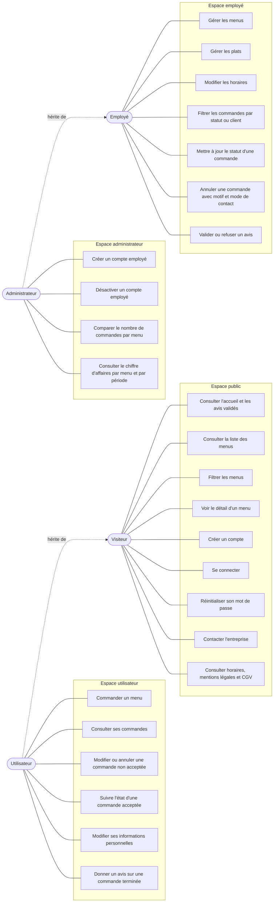
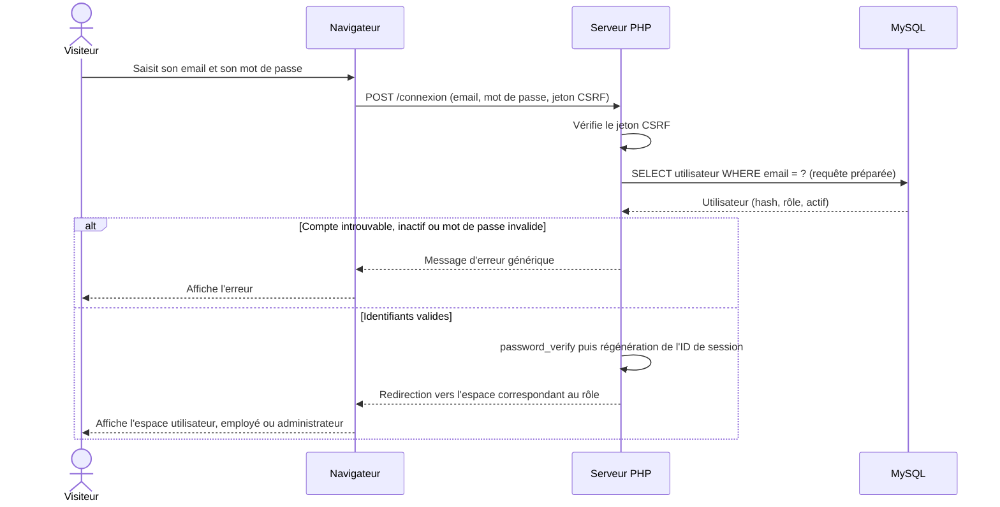
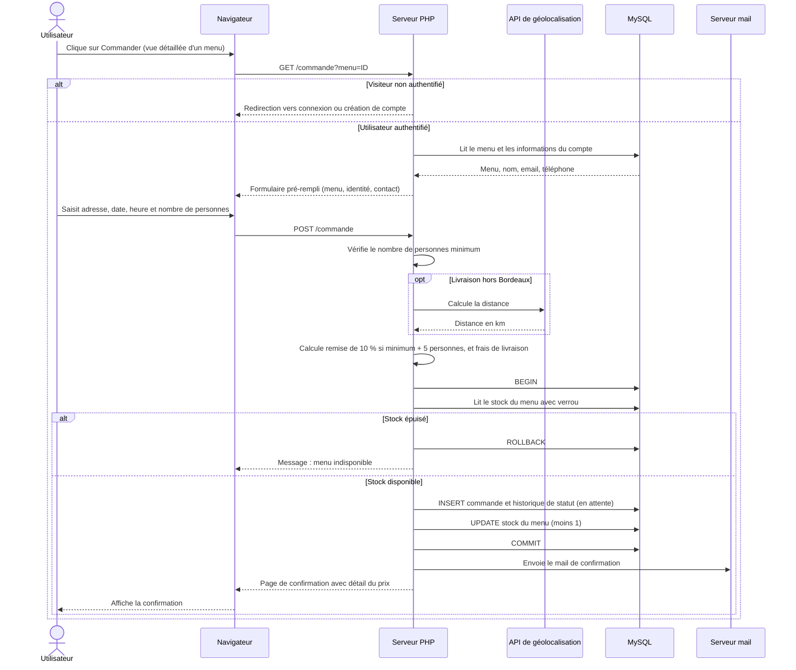
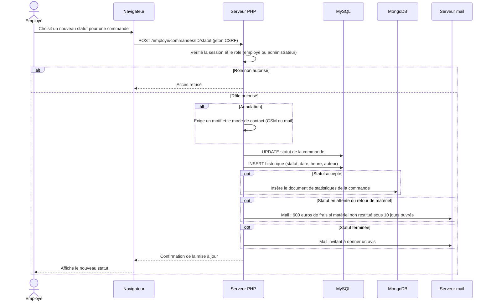

# Diagrammes

## 1. Diagramme de cas d'utilisation

L'utilisateur connecté conserve les possibilités du visiteur. L'administrateur peut faire
tout ce que fait un employé.

## 2. Diagramme de séquence : connexion

## 3. Diagramme de séquence : commande d'un menu

## 4. Diagramme de séquence : changement de statut d'une commande

