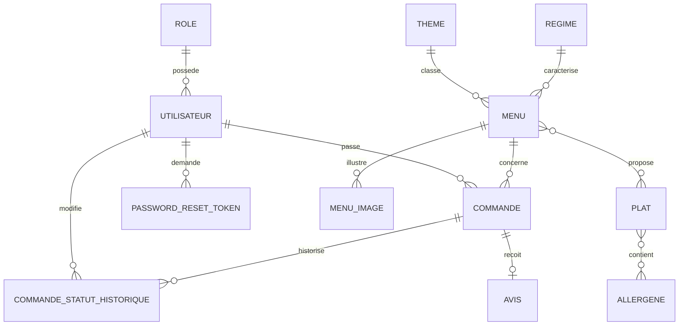

# Modèle de données (MySQL)



## Collection MongoDB : `commandes_stats`

Un document par commande validée, utilisé pour les statistiques de l'espace administrateur.

```json
{
  "commande_id": 42,
  "menu_id": 3,
  "menu_titre": "Menu de Noël",
  "date_prestation": "2026-12-20",
  "nombre_personne": 12,
  "montant": 245.50
}
```
