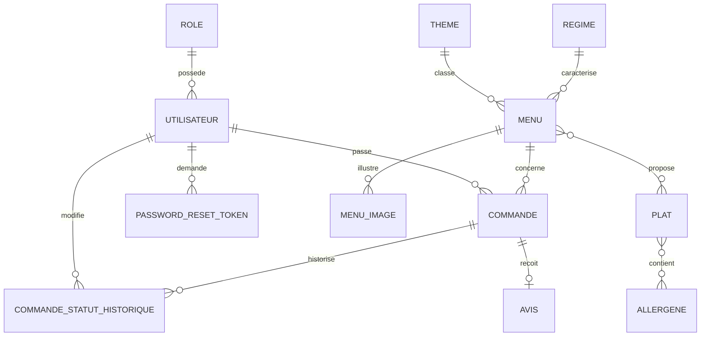

# Modèle de données (MySQL)



## Collection MongoDB : `commandes_stats`

Un document par commande **acceptée**, utilisé pour les statistiques de l'espace administrateur
(nombre de commandes par menu, chiffre d'affaires par menu et par période).

```json
{
  "commande_id": 42,
  "menu_id": 3,
  "menu_titre": "Menu de Noël traditionnel",
  "date_prestation": { "$date": "2026-12-20T00:00:00Z" },
  "date_acceptation": { "$date": "2026-12-01T10:15:00Z" },
  "nombre_personne": 12,
  "montant_centimes": 24550
}
```

Règles :
- Document créé quand l'employé passe la commande au statut « accepté », et supprimé si la commande
  acceptée est ensuite annulée.
- Écriture en *upsert* sur `commande_id` : aucun doublon, et une resynchronisation depuis MySQL
  est possible sans risque.
- Montants en centimes (entiers) pour éviter les erreurs d'arrondi.
- Le titre du menu est dupliqué volontairement : les statistiques restent lisibles même si le menu
  est renommé ou désactivé.
- Index : `commande_id` (unique) et `(menu_id, date_prestation)`.
- Période du chiffre d'affaires filtrée sur `date_prestation`.
